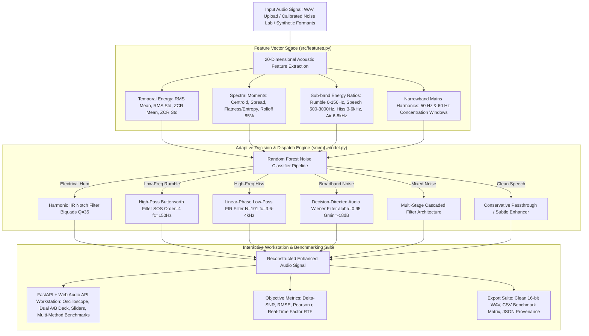

# Adaptive ML-Assisted Audio Noise Reduction Using FIR/IIR Filters & Time-Frequency Spectral Enhancement

[](https://www.python.org/)
[](LICENSE)
[](tests/)
[](models/metadata.json)
[](server.py)
[](matlab/)
[](README_AI.md)

An academic and industrial digital signal processing (DSP) suite integrating classical filter designs (FIR, IIR Butterworth SOS, harmonic notch biquads), time-frequency spectral restoration (STFT spectral gating, Ephraim-Malah Decision-Directed Wiener filtering), machine-learning noise diagnosis (Random Forest on 20 acoustic features), and an interactive real-time software workstation for audio enhancement and objective benchmarking.

> 🤖 **Looking for an AI Agent Onboarding Guide?** See [README_AI.md](file:///c:/Users/ayush/Desktop/DTSP/README_AI.md) and [AGENTS.md](file:///c:/Users/ayush/Desktop/DTSP/AGENTS.md) for complete technical architecture, REST API references, and invariant rules optimized for autonomous agents.

---

## Table of Contents
1. [Project Overview & Objectives](#1-project-overview--objectives)
2. [End-to-End Architecture](#2-end-to-end-architecture)
3. [DSP Foundations & Mathematical Formulations](#3-dsp-foundations--mathematical-formulations)
   - [A. Linear-Phase FIR Filters](#a-linear-phase-fir-filters-srcfilterspy)
   - [B. IIR Butterworth Filters in Second-Order Sections (SOS)](#b-iir-butterworth-filters-in-second-order-sections-sos-srcfilterspy)
   - [C. Harmonic IIR Notch Filters](#c-harmonic-iir-notch-filters-srcfilterspy)
   - [D. STFT Spectral Gating with 2D Gaussian Smoothing](#d-stft-spectral-gating-with-2d-gaussian-smoothing-srcspectral_denoisingpy)
   - [E. Decision-Directed Audio Wiener Filter](#e-decision-directed-audio-wiener-filter-srcspectral_denoisingpy)
4. [Machine Learning Noise Diagnosis Engine](#4-machine-learning-noise-diagnosis-engine)
   - [20-Dimensional Acoustic Feature Vector](#20-dimensional-acoustic-feature-vector)
   - [Classification Pipeline & Zero-Data-Leakage Protocol](#classification-pipeline--zero-data-leakage-protocol)
   - [Empirical Validation Results & Metrics](#empirical-validation-results--metrics)
   - [Dynamic Strategy Dispatching Matrix](#dynamic-strategy-dispatching-matrix)
5. [SonicPure Web Audio Workstation (FastAPI + HTML5/CSS3/Vanilla JS)](#5-sonicpure-web-audio-workstation-fastapi--html5css3vanilla-js)
6. [MATLAB / GNU Octave Full Implementation Suite](#6-matlab--gnu-octave-full-implementation-suite)
7. [Controlled Noise Simulation & Mathematical SNR Calibration](#7-controlled-noise-simulation--mathematical-snr-calibration)
8. [Quantitative Evaluation & Objective Benchmarking](#8-quantitative-evaluation--objective-benchmarking)
9. [Repository Layout](#9-repository-layout)
10. [Installation & Setup](#10-installation--setup)
11. [Running the Project](#11-running-the-project)
12. [Automated Verification & Test Evidence](#12-automated-verification--test-evidence)
13. [DSP Limitations, Edge Cases & Practical Trade-Offs](#13-dsp-limitations-edge-cases--practical-trade-offs)
14. [Troubleshooting & FAQ](#14-troubleshooting--faq)
15. [License & Acknowledgments](#15-license--acknowledgments)

---

## 1. Project Overview & Objectives

In speech communication, assistive hearing technologies, and audio forensics, background acoustic interference severely degrades speech intelligibility and quality. Classical static filters (e.g., fixed low-pass, high-pass, or notch filters) applied indiscriminately inevitably damage essential speech components:
- **Formants ($F_1 \approx 300\text{--}900\text{ Hz}$, $F_2 \approx 900\text{--}2500\text{ Hz}$)** overlap directly with HVAC rumble, engine noise, and hum harmonics. Static high-pass or notch filters color vowel timbre.
- **Unvoiced Consonants / Fricatives ('s', 'sh', 'f' in $3.5\text{--}8\text{ kHz}$)** carry primary phonetic intelligibility but overlap directly with thermal hiss and tape noise. Static low-pass filters eliminate consonant crispness, turning speech muffled and unintelligible.
- **Broadband / Pink Noise** spans the entire spectrum, rendering 1D linear filters ineffective without completely mutilating speech energy.

**SonicPure DSP** resolves this trade-off through a closed-loop **ML-Assisted Content-Adaptive Framework**:
1. **Intelligent Noise Diagnosis**: Before applying any filtering, the system inspects temporal and spectral characteristics across a 20-dimensional acoustic feature space.
2. **Dynamic Strategy Dispatch**: An automated decision engine selects and tunes the exact mathematical filtering topology best suited for the diagnosed interference (e.g., surgical harmonic notch for mains hum, linear-phase FIR for tape hiss, high-pass Butterworth SOS for HVAC rumble, or Decision-Directed Wiener filtering for broadband noise).
3. **Modern Real-Time Software Workstation**: Zero hardware setup is required (no DSP development boards, ESP32, or external microcontrollers). Users interact with the algorithms via a **high-performance, real-time HTML5/CSS3/JS Web Workstation** powered by a FastAPI REST backend.
4. **Rigorous Verification & Objective Metrics**: Every filtering operation is quantitatively benchmarked using SNR improvement ($\Delta\text{SNR}$), RMSE, Pearson correlation ($r$), and Real-Time Factor (RTF), complemented by paired waveform and STFT spectrogram heatmaps in decibels.
5. **Cross-Platform Parity**: The entire DSP and adaptive pipeline is duplicated in native **MATLAB / GNU Octave** scripts, ensuring reproducibility across both Python and engineering math environments.

---

## 2. End-to-End Architecture



---

## 3. DSP Foundations & Mathematical Formulations

### A. Linear-Phase FIR Filters (`src/filters.py`)
Designed via the window method using `scipy.signal.firwin`:
$$h[n] = h_d[n] \cdot w[n], \quad 0 \le n \le M-1$$

- **Linear Phase Property**: Symmetric Type-I FIR filters ($M$ taps odd, $h[n] = h[M-1-n]$) exhibit an exactly constant group delay:
  $$\tau_g(\omega) = -\frac{d\theta(\omega)}{d\omega} = \frac{M - 1}{2} \text{ samples}$$
  This guarantees **zero phase distortion**, preserving the temporal envelope and phase alignment of vocal formants.
- **Window Types Supported**:
  - **Hamming**: $w[n] = 0.54 - 0.46 \cos\left(\frac{2\pi n}{M-1}\right)$ (Moderate transition width, $-53\text{ dB}$ sidelobes).
  - **Hann**: $w[n] = 0.5\left[1 - \cos\left(\frac{2\pi n}{M-1}\right)\right]$ (Gentle roll-off, reduced leakage).
  - **Blackman**: $w[n] = 0.42 - 0.5 \cos\left(\frac{2\pi n}{M-1}\right) + 0.08 \cos\left(\frac{4\pi n}{M-1}\right)$ (Extremely low stopband ripple, $-74\text{ dB}$ sidelobes).
  - **Rectangular**: Highest frequency resolution, but high sidelobe ripple ($-13\text{ dB}$).
- **Modes**: Low-pass, high-pass, and band-pass filtering.

### B. IIR Butterworth Filters in Second-Order Sections (SOS) (`src/filters.py`)
Designed using the analog prototype transformed via the bilinear transform and factored into Second-Order Sections (SOS):
$$|H(j\omega)|^2 = \frac{1}{1 + \left(\frac{\omega}{\omega_c}\right)^{2N}}$$

- **Passband Characteristics**: Maximally flat frequency response with zero passband ripple and monotonic attenuation in the stopband.
- **Second-Order Sections (SOS)**: Higher-order IIR polynomials are decomposed into cascaded biquadratic sections:
  $$H(z) = g \cdot \prod_{k=1}^{\lceil N/2 \rceil} \frac{b_{0k} + b_{1k} z^{-1} + b_{2k} z^{-2}}{1 + a_{1k} z^{-1} + a_{2k} z^{-2}}$$
  This eliminates catastrophic coefficient quantization errors and pole sensitivity inherent in direct-form implementations.
- **Zero-Phase vs. Causal Execution**:
  - **Causal Mode (`sosfilt`)**: Realizable in real-time streaming engines; introduces minimal frequency-dependent group delay.
  - **Zero-Phase Mode (`sosfiltfilt`)**: Bidirectional forward-reverse filtering eliminating all phase lag ($H(z)H(z^{-1})$), ideal for studio master rendering.

### C. Harmonic IIR Notch Filters (`src/filters.py`)
Implemented as cascaded digital biquads targeting powerline fundamental hum and upper odd/even harmonics (e.g., 50 Hz, 100 Hz, 150 Hz, 200 Hz or 60 Hz, 120 Hz, 180 Hz):
$$H(z) = \frac{1 - 2\cos(\omega_0)z^{-1} + z^{-2}}{1 - 2r\cos(\omega_0)z^{-1} + r^2 z^{-2}}$$
where:
$$\omega_0 = \frac{2\pi f_0}{f_s}, \quad r \approx 1 - \frac{\pi \Delta f}{f_s}, \quad Q = \frac{f_0}{\Delta f}$$

- High quality factor ($Q = 35$) provides deep attenuation ($> 40\text{ dB}$) in a narrow notch bandwidth, eliminating hum while leaving adjacent vocal energy untouched.

### D. STFT Spectral Gating with 2D Gaussian Smoothing (`src/spectral_denoising.py`)
Time-frequency domain spectral subtraction designed to suppress stationary noise floors without hardware accelerators:
1. Computes the Short-Time Fourier Transform (STFT) with a 512-point Hann window and 75% overlap ($N_{\text{hop}} = 128$).
2. Estimates the stationary noise spectrum $|N(f)|$ from the quietest quantile frames (default: lowest 15th percentile energy frames).
3. Evaluates raw spectral over-subtraction with over-subtraction factor $\alpha \ge 1.0$ and minimum gain floor $G_{\min}$:
   $$G_{\text{raw}}(t, f) = \max\left(G_{\min}, \frac{|Y(t, f)| - \alpha |N(f)|}{|Y(t, f)| + \epsilon}\right)$$
4. **2D Time-Frequency Smoothing**: Applies a 2D Gaussian kernel ($\sigma_t = 1.0$, $\sigma_f = 1.5$) over the time-frequency gain matrix:
   $$\tilde{G}(t, f) = G_{\text{raw}}(t, f) * K_{\text{Gauss}}(t, f)$$
   This step eliminates isolated spectral peaks ("musical noise" / "space monkeys") before reconstructing time-domain audio via inverse STFT with overlap-add synthesis.

### E. Decision-Directed Audio Wiener Filter (`src/spectral_denoising.py`)
Implements the speech-enhancement formulation developed by Ephraim & Malah:
1. **A Posteriori SNR**:
   $$\gamma(t, f) = \frac{|Y(t, f)|^2}{\beta P_N(f)}$$
   where $\beta \ge 1.0$ is the noise overestimation factor.
2. **A Priori SNR Recursive Tracking** ($\alpha \approx 0.95\text{--}0.98$):
   $$\xi(t, f) = \alpha \frac{|\hat{S}(t-1, f)|^2}{P_N(f)} + (1 - \alpha) \max(\gamma(t, f) - 1, 0)$$
   Recursive memory prevents musical noise by tracking speech priors smoothly over successive frames.
3. **Wiener Gain Transfer Function**:
   $$H(t, f) = \max\left(\frac{\xi(t, f)}{\xi(t, f) + 1}, G_{\min}\right)$$
4. The synthesized speech spectrum is obtained as $\hat{S}(t, f) = H(t, f) \cdot Y(t, f)$, then inverted via iSTFT.

---

## 4. Machine Learning Noise Diagnosis Engine

### 20-Dimensional Acoustic Feature Vector
Extracted by `src/features.py` over 512-sample frames with 256-sample hop:

| Index | Feature Key | Dimension / Type | Physical Meaning & Diagnostic Target |
|:---:|:---|:---:|:---|
| 1--2 | `rms_mean`, `rms_std` | Temporal Energy | Overall signal volume and dynamic range fluctuations |
| 3--4 | `zcr_mean`, `zcr_std` | Zero-Crossing Rate | Density of sign changes (high in unvoiced fricatives and white noise) |
| 5--6 | `spectral_centroid_mean`, `spectral_centroid_std` | Spectral Center of Mass | Perceived brightness; differentiates low rumble from high hiss |
| 7--8 | `spectral_flatness_mean`, `spectral_flatness_std` | Wiener Entropy | Ratio of geometric to arithmetic mean of power spectrum (0 = tonal hum, 1 = white noise) |
| 9--10 | `spectral_rolloff_mean`, `spectral_rolloff_std` | 85% Energy Boundary | Frequency below which 85% of spectral magnitude resides |
| 11 | `spectral_bandwidth_mean` | Spectral Spread | 2nd moment of spectrum around centroid |
| 12 | `energy_ratio_rumble` | Sub-band $[0, 150]\text{ Hz}$ | Concentration of mechanical, HVAC, and wind rumble |
| 13 | `energy_ratio_low` | Sub-band $[150, 500]\text{ Hz}$ | Lower male fundamental vocal pitch and chest resonance |
| 14 | `energy_ratio_mid` | Sub-band $[500, 3000]\text{ Hz}$ | Primary vowel formants ($F_1, F_2$) and core speech energy |
| 15 | `energy_ratio_high` | Sub-band $[3000, 6000]\text{ Hz}$ | Fricatives and analog tape hiss |
| 16 | `energy_ratio_air` | Sub-band $[6000, 8000]\text{ Hz}$ | High-frequency acoustic air and shimmer |
| 17 | `dominant_peak_freq` | Frequency (Hz) | Location of sharpest spectral resonance |
| 18 | `dominant_peak_ratio` | Magnitude Ratio | Prominence of dominant peak relative to total power |
| 19 | `hum_50hz_ratio` | Band $[44, 56]\text{ Hz}$ | Energy concentration around European/Asian 50 Hz mains power |
| 20 | `hum_60hz_ratio` | Band $[54, 66]\text{ Hz}$ | Energy concentration around North American 60 Hz mains power |

### Classification Pipeline & Zero-Data-Leakage Protocol
- **Classifier**: Scikit-Learn `RandomForestClassifier` (100 estimators, `max_depth=12`, `min_samples_split=4`, balanced class weights) preceded by a `StandardScaler`.
- **Zero Data Leakage Protocol**:
  Unlike naive implementations that augment audio first and then split into train/test, our pipeline **splits source speech utterances into disjoint train (80%) and test (20%) sets before any noise generation occurs**. The model is evaluated strictly on speech utterances it has never encountered during training.
- **Dataset Size**: 544 training samples and 104 held-out test samples across 5 balanced acoustic classes.

### Empirical Validation Results & Metrics
Verified directly from the serialized model artifact (`models/metadata.json`):

```
Held-Out Test Set Accuracy: 98.08%
Total Test Samples: 104
Macro Average F1-Score: 0.9833
Weighted Average F1-Score: 0.9807
```

#### Detailed Classification Report:
| Class | Precision | Recall | F1-Score | Support |
|:---|:---:|:---:|:---:|:---:|
| **Broadband Noise** | **1.0000** | **1.0000** | **1.0000** | 24 |
| **Clean Speech** | **1.0000** | **1.0000** | **1.0000** | 8 |
| **Electrical Hum** | **0.9231** | **1.0000** | **0.9600** | 24 |
| **High-Frequency Hiss** | **1.0000** | **1.0000** | **1.0000** | 24 |
| **Low-Frequency Rumble** | **1.0000** | **0.9167** | **0.9565** | 24 |
| **Overall Accuracy** | — | — | **0.9808** | **104** |

#### Confusion Matrix:
$$\begin{pmatrix}
24 & 0 & 0 & 0 & 0 \\
2 & 22 & 0 & 0 & 0 \\
0 & 0 & 24 & 0 & 0 \\
0 & 0 & 0 & 24 & 0 \\
0 & 0 & 0 & 0 & 8
\end{pmatrix}$$

#### Top Feature Importances:
1. `hum_60hz_ratio` (16.53%)
2. `spectral_centroid_mean` (10.54%)
3. `spectral_centroid_std` (9.26%)
4. `zcr_mean` (7.79%)
5. `zcr_std` (7.47%)
6. `spectral_rolloff_mean` (6.54%)
7. `spectral_flatness_mean` (5.53%)
8. `spectral_flatness_std` (5.49%)

### Dynamic Strategy Dispatching Matrix
When audio is evaluated by `NoiseClassifier.get_adaptive_strategy()`, the engine dispatches tailored filter configurations:

| Diagnosed Class | Dispatched DSP Strategy | Optimal Parameters | Rationale |
|:---|:---|:---|:---|
| **Electrical Hum** | Harmonic IIR Notch Biquads | $f_0 \in \{50, 60\}\text{ Hz}$, $Q=35$, 4 harmonics, zero-phase | Eliminates line frequency and odd/even harmonics without altering speech vowels |
| **Low-Frequency Rumble** | High-Pass Butterworth (SOS) | Order $N=4$, $f_c=150\text{ Hz}$, zero-phase | Removes sub-vocal rumble below normal human speech fundamental frequencies |
| **High-Frequency Hiss** | Low-Pass Linear-Phase FIR | $N=101$ taps, $f_c=3600\text{--}4000\text{ Hz}$, Hamming window | Steep linear-phase attenuation of tape hiss without group delay phase distortion |
| **Broadband Noise** | Decision-Directed Wiener Filter | $\alpha=0.95$, overestimation $\beta=1.25$, $G_{\min}=-18\text{ dB}$ | Frequency-domain suppression of stationary noise without musical noise artifacts |
| **Clean Speech** | Passthrough / Subtle Enhancer | $\alpha=0.98$, $G_{\min}=-6\text{ dB}$ | Minimal processing to ensure zero audible coloration or formant degradation |
| **Mixed Noise** | Multi-Stage Cascade | Cascaded Notch + Highpass + DD Wiener | Sequential surgical suppression of narrowband tones followed by broadband cleanup |

---

## 5. SonicPure Web Audio Workstation (FastAPI + HTML5/CSS3/Vanilla JS)
*Powered by `server.py` and static assets in `web/`.*

Designed for rapid, low-latency audio interaction, real-time visualization, and automated DSP benchmarking:
- **Real-Time Web Audio Oscilloscope**: Live HTML5 Canvas rendering of the audio time-domain waveform during playback.
- **Dual A/B Comparison Deck**: Side-by-side synchronized players for the Noisy Input and Denoised Output with scrubbing, duration timecodes, and direct WAV download.
- **1-Click Quick Presets Toolbar**: Instant switching between 50 Hz Hum, HVAC Rumble, Tape Hiss, Pink Noise, and Clean Speech.
- **Custom Noise Lab Modal**: Synthesize custom noise mixtures with real-time target SNR sliders ($-10\text{ dB}$ to $+20\text{ dB}$).
- **Interactive Filter Workbench**: Parametric controls for Cutoff Frequency, Filter Order, Window Type, Quality Factor $Q$, Gain Floor, and Over-subtraction.
- **Automated ML Classification & Benchmark Suite**: On-demand classification of input noise profiles, dynamic filter recommendation, and head-to-head multi-method benchmarks with direct CSV/JSON export.
- **RESTful API Architecture**:
  - `GET /api/status`: Readiness, sample rate, audio source metadata.
  - `POST /api/upload`: Upload external WAV files.
  - `POST /api/process`: Execute DSP filtering (FIR, Butterworth, Notch, Spectral Gating, Wiener, Adaptive ML).
  - `POST /api/diagnose`: Perform on-demand ML noise classification.
  - `POST /api/benchmark`: Run head-to-head multi-method benchmarks.
  - `GET /api/export/csv`: Export benchmark results as formatted CSV.
  - `GET /api/export/json`: Export full experiment metadata as JSON.

---

## 6. MATLAB / GNU Octave Full Implementation Suite

The `matlab/` directory provides a 100% native MATLAB / GNU Octave mirror of the entire DSP and machine learning pipeline, requiring **zero paid toolboxes**:

| Script | Purpose & Functionality |
|:---|:---|
| `main_audio_denoising_demo.m` | Master script: synthesizes speech, injects calibrated noise, runs ML adaptive dispatch, benchmarks all 5 filters, and plots waveforms/spectrograms. |
| `apply_fir_filter.m` | Windowed FIR filter implementation supporting Hamming, Hann, Blackman, and Rectangular windows with causal and zero-phase modes. |
| `apply_butterworth_filter.m` | Butterworth IIR filter implemented via cascaded Second-Order Sections (SOS) for numerical stability. |
| `apply_notch_filter.m` | Harmonic notch filter biquad cascading notches for 50/60 Hz and upper integer harmonics. |
| `spectral_gating.m` | STFT-based spectral noise gating with quantile noise floor tracking and minimum gain floors. |
| `wiener_filter_audio.m` | Decision-Directed audio Wiener filter tracking a priori SNR via Ephraim-Malah recursion. |
| `extract_audio_features.m` | Extracts physical and spectral audio features (RMS, ZCR, Centroid, Flatness, Sub-band ratios, 50/60 Hz energy). |
| `adaptive_filter_dispatch.m` | Rule-based and classifier-assisted decision engine that dispatches the optimal MATLAB filter function. |

---

## 7. Controlled Noise Simulation & Mathematical SNR Calibration

`src/noise_generation.py` provides mathematical synthesis of physical interference types:
- **Electrical Mains Hum**: Fundamental sine wave ($50\text{ Hz}$ or $60\text{ Hz}$) plus harmonics at $2f_0, 3f_0, 4f_0$ with physically realistic $1/k$ harmonic amplitude falloff.
- **Low-Frequency Rumble**: Pink noise shaped through a 2nd-order Butterworth low-pass filter at $130\text{ Hz}$ simulating air conditioner vibration, wind buffeting, or mechanical handling noise.
- **High-Frequency Hiss**: White Gaussian noise shaped through a 2nd-order Butterworth high-pass filter at $3600\text{ Hz}$ simulating analog tape hiss and preamp thermal noise.
- **Broadband Noise**: Synthesized White Gaussian noise ($S(f) = \text{const}$) or Pink noise ($S(f) \propto 1/f$).
- **Multi-Source Mixed Noise**: Linear combination of mains hum, low-frequency rumble, and high-frequency hiss.

### Exact Mathematical SNR Calibration
To mix clean speech $s[n]$ with noise $v[n]$ at an exact target signal-to-noise ratio $\text{SNR}_{\text{target}}$:
1. Compute the active speech power:
   $$P_{\text{speech}} = \frac{1}{N} \sum_{n=1}^N s[n]^2$$
2. Compute the raw noise power:
   $$P_{\text{noise}} = \frac{1}{N} \sum_{n=1}^N v[n]^2$$
3. Derive the exact scaling coefficient $k$:
   $$k = \sqrt{\frac{P_{\text{speech}}}{P_{\text{noise}} \cdot 10^{\frac{\text{SNR}_{\text{target}}}{10}}}}$$
4. Synthesize the noisy composite signal:
   $$y[n] = s[n] + k \cdot v[n]$$
This guarantees the exact desired SNR across all calibration test points ($-5, 0, 5, 10, 20\text{ dB}$).

---

## 8. Quantitative Evaluation & Objective Benchmarking

`src/evaluation.py` implements standardized reference-based and unpaired acoustic metrics:

### A. Reference-Based Metrics (Clean Speech Available)
When ground-truth speech $s[n]$ is available:

- **Signal-to-Noise Ratio Improvement ($\Delta\text{SNR}$)**:
  $$\text{SNR}_{\text{in}} = 10 \log_{10}\left(\frac{\sum s[n]^2}{\sum (y[n] - s[n])^2 + \epsilon}\right)$$
  $$\text{SNR}_{\text{out}} = 10 \log_{10}\left(\frac{\sum s[n]^2}{\sum (\hat{s}[n] - s[n])^2 + \epsilon}\right)$$
  $$\Delta\text{SNR} = \text{SNR}_{\text{out}} - \text{SNR}_{\text{in}} \quad (\text{dB})$$
- **Root Mean Square Error (RMSE)**:
  $$\text{RMSE} = \sqrt{\frac{1}{N} \sum_{n=1}^N (\hat{s}[n] - s[n])^2}$$
- **Pearson Correlation Coefficient ($r$)**:
  $$r = \frac{\sum (\hat{s}[n] - \bar{\hat{s}})(s[n] - \bar{s})}{\sqrt{\sum (\hat{s}[n] - \bar{\hat{s}})^2 \sum (s[n] - \bar{s})^2}}$$
- **Real-Time Factor (RTF)**:
  $$\text{RTF} = \frac{\text{Execution Wall-Clock Time (s)}}{\text{Audio Duration (s)}}$$
  An $\text{RTF} < 1.0$ confirms the algorithm is capable of real-time execution. In our suite, FIR and IIR filters operate with $\text{RTF} < 0.05$.

### B. Unpaired Descriptive Indicators (No Clean Reference)
When processing live microphone feeds or field recordings without ground-truth clean audio:
- **Output RMS Level (dBFS)**: Verifies that filtering maintains healthy audio gain without clipping ($0\text{ dBFS}$) or excessive attenuation.
- **Sub-Band Energy Attenuation ($\text{dB}$)**:
  $$\text{Atten}_{\text{band}} = 10 \log_{10}\left(\frac{P_{\text{in, band}}}{P_{\text{out, band}} + \epsilon}\right)$$
  Evaluated across the **Rumble Band** ($0\text{--}150\text{ Hz}$), **Speech Band** ($500\text{--}3000\text{ Hz}$), and **Hiss Band** ($3000\text{--}6000\text{ Hz}$).

---

## 9. Repository Layout

```
DTSP/
├── run_workstation.bat             # 1-Click launcher (starts backend & frontend, opens browser)
├── run.bat                         # Quick-start alias launcher
├── server.py                       # SonicPure Web Audio Server (FastAPI REST backend, port 5000)
├── requirements.txt                # Pinned dependencies (numpy, scipy, scikit-learn, fastapi, etc.)
├── README.md                       # Comprehensive project documentation
├── .gitignore                      # Python, temporary data, audio cache, and IDE ignores
│
├── web/                            # Modern Web Audio API Workstation frontend
│   ├── index.html                  # Semantic HTML5 workstation layout
│   ├── styles.css                  # Custom CSS design system, dark glassmorphism
│   └── app.js                      # Real-time Web Audio oscilloscope, A/B dual player, API hooks
│
├── src/                            # Core Digital Signal Processing & ML modules
│   ├── __init__.py                 # Package version and export definitions
│   ├── audio_io.py                 # WAV loader/writer, resampling, synthetic speech generator
│   ├── noise_generation.py         # Physical noise generators & exact mathematical SNR mixer
│   ├── filters.py                  # Linear-phase FIR, IIR Butterworth SOS, harmonic notch biquads
│   ├── spectral_denoising.py       # STFT spectral gating (2D smoothed) & Decision-Directed Wiener
│   ├── features.py                 # 20-dimensional temporal and spectral acoustic feature extractor
│   ├── ml_model.py                 # Random Forest classifier & dynamic filter strategy dispatcher
│   ├── evaluation.py               # Objective benchmarking metrics (Delta-SNR, RMSE, Pearson r, RTF)
│   ├── visualizations.py           # Plotly interactive waveforms, spectrogram heatmaps, filter responses
│   └── reporting.py                # JSON metadata exporter, CSV tables, and Markdown lab reports
│
├── matlab/                         # Native MATLAB / GNU Octave implementation suite
│   ├── README.md                   # MATLAB usage guide and quick-start instructions
│   ├── main_audio_denoising_demo.m # Master demo and benchmark runner
│   ├── apply_fir_filter.m          # Windowed FIR filter implementation
│   ├── apply_butterworth_filter.m  # Butterworth SOS IIR filter
│   ├── apply_notch_filter.m        # Harmonic notch biquad filter
│   ├── spectral_gating.m           # STFT spectral noise gating
│   ├── wiener_filter_audio.m       # Decision-Directed audio Wiener filter
│   ├── extract_audio_features.m    # Acoustic feature extractor
│   └── adaptive_filter_dispatch.m  # ML adaptive noise classifier and dispatcher
│
├── tests/                          # Automated Pytest unit & integration test suite
│   ├── __init__.py
│   ├── test_audio_io.py            # WAV IO, byte serialization, synthetic speech generation
│   ├── test_noise_generation.py    # Noise models and exact calibrated SNR mixing tests
│   ├── test_filters.py             # FIR, Butterworth SOS, and Notch attenuation & parameter tests
│   ├── test_spectral_denoising.py  # Spectral gating and Wiener filter execution tests
│   ├── test_features.py            # 20-D feature extraction sanity & discrimination tests
│   ├── test_ml_model.py            # Model serialization, accuracy, and adaptive dispatch tests
│   └── test_evaluation.py          # Reference-based and unpaired metric mathematical correctness
│
├── scripts/                        # Utility & automation scripts
│   ├── train_model.py              # Zero-data-leakage model training & serialization script
│   └── prepare_dataset.py          # VoiceBank-DEMAND dataset ingestion and resampling utility
│
├── models/                         # Serialized machine learning models & metadata
│   ├── README.md                   # Model provenance and evaluation notes
│   ├── metadata.json               # Training metadata, confusion matrix, and classification report
│   └── noise_classifier.joblib     # Serialized Scikit-Learn Random Forest pipeline
│
├── data/                           # Audio data and benchmark samples
│   ├── README.md                   # Data documentation
│   └── samples/                    # Bundled 16 kHz clean reference audio library
│       ├── clean_male_speech_01.wav     # Male studio voice (110 Hz, Harvard sentence)
│       ├── clean_female_speech_01.wav   # Female studio voice (211 Hz, crisp consonants)
│       ├── clean_female_speech_02.wav   # Female expressive voice (229 Hz, high treble)
│       ├── clean_male_speech_02.wav     # Male baritone narrative voice (117 Hz)
│       ├── clean_female_speech_03.wav   # Female conversational voice (199 Hz)
│       ├── clean_male_speech_03.wav     # Male deep resonant chest voice (112 Hz)
│       ├── clean_acoustic_instrument.wav# Plucked acoustic guitar chord arpeggio
│       ├── clean_synthetic_speech.wav   # Formant synthesis reference (F1-F3 model)
│       └── clean_sample.wav             # Baseline legacy reference audio
│
└── outputs/                        # Destination for exported audio WAVs, CSVs, and reports
    └── README.md
```

---

## 10. Installation & Setup

### Prerequisites
- Python **3.11** or **3.12**
- Git
- Recommended: Isolated virtual environment (`venv` or `conda`)

### Step-by-Step Installation

#### Windows (PowerShell)
```powershell
# Navigate to project root
cd c:\Users\ayush\Desktop\DTSP

# Create virtual environment
python -m venv venv

# Activate virtual environment
.\venv\Scripts\Activate.ps1

# Upgrade pip and install pinned dependencies
python -m pip install --upgrade pip
pip install -r requirements.txt
```

#### Linux / macOS (Bash)
```bash
# Navigate to project root
cd /path/to/DTSP

# Create virtual environment
python3 -m venv venv

# Activate virtual environment
source venv/bin/activate

# Upgrade pip and install dependencies
python3 -m pip install --upgrade pip
pip install -r requirements.txt
```

---

## 11. Running the Project

### Option 1: 1-Click Launch with Batch File (Backend + Frontend)
Double-click `run.bat` or `run_workstation.bat`, or run from terminal:
```cmd
run_workstation.bat
```
This automatically verifies Python runtime, launches the FastAPI server (serving both REST backend APIs and the HTML5/CSS3/JS Web Workstation on port 5000), and opens `http://localhost:5000` in your default browser.

### Option 2: Launch via Python Directly
```bash
python server.py
```
Or with Uvicorn:
```bash
uvicorn server:app --host 0.0.0.0 --port 5000 --reload
```
Open your browser at **`http://localhost:5000`**.

### Option 3: Run the Automated Pytest Suite
```bash
pytest tests -v
```
Executes all 26 unit and integration tests across audio IO, noise simulation, filter design, spectral restoration, feature extraction, ML classification, and metrics computation.

### Option 4: Train / Re-Train the Noise Classifier
```bash
python scripts/train_model.py
```
Retrains the Random Forest pipeline with the zero-data-leakage protocol, serializes the updated artifact to `models/noise_classifier.joblib`, and writes test metrics to `models/metadata.json`.

### Option 5: Ingest External Datasets (e.g., VoiceBank-DEMAND)
```bash
python scripts/prepare_dataset.py --dataset_dir /path/to/voicebank_root --output_dir data/voicebank_16k
```

### Option 6: Run in MATLAB / GNU Octave
In MATLAB or GNU Octave:
```matlab
cd matlab
main_audio_denoising_demo
```
Or from the system terminal:
```bash
matlab -batch "cd matlab; main_audio_denoising_demo"
```

---

## 12. Automated Verification & Test Evidence

The project includes 26 rigorous unit and integration tests covering the entire DSP and machine learning pipeline. Running `pytest tests -v` validates:
- **Audio IO (`tests/test_audio_io.py`)**: Validates synthetic formant speech generation, WAV encoding/decoding round-trips, in-memory byte streaming, audio metadata calculation, and invalid file error handling.
- **Evaluation Metrics (`tests/test_evaluation.py`)**: Confirms mathematical correctness of $\Delta\text{SNR}$, RMSE, Pearson $r$, RTF, and unpaired sub-band attenuation against analytical test vectors.
- **Feature Extraction (`tests/test_features.py`)**: Verifies 20-dimensional output shapes, non-null finite values, and spectral hum discrimination between 50 Hz and 60 Hz mains power.
- **Filter Designs (`tests/test_filters.py`)**: Validates FIR low-pass stopband attenuation ($> 20\text{ dB}$), Butterworth high-pass rumble suppression, harmonic notch depth at 50 Hz, parameter validation boundaries, and frequency response calculation.
- **Machine Learning (`tests/test_ml_model.py`)**: Asserts untrained classifier exceptions, pipeline serialization loading, multi-class prediction accuracy on known noise classes, and end-to-end adaptive filtering execution.
- **Noise Generation (`tests/test_noise_generation.py`)**: Verifies noise generator waveforms, finite ranges, and mathematically exact SNR calibration across $-5, 0, 5, 10, 20\text{ dB}$.
- **Spectral Denoising (`tests/test_spectral_denoising.py`)**: Confirms STFT spectral gating execution, shape preservation, Decision-Directed Wiener filter stability, and noise floor profile estimation.

```
============================= test session starts =============================
platform win32 -- Python 3.12.8, pytest-8.3.3
collected 26 items

tests/test_audio_io.py::test_generate_clean_speech_synthetic PASSED      [  3%]
tests/test_audio_io.py::test_save_and_load_audio_roundtrip PASSED        [  7%]
tests/test_audio_io.py::test_audio_to_bytes PASSED                       [ 11%]
tests/test_audio_io.py::test_get_audio_metadata PASSED                   [ 15%]
tests/test_audio_io.py::test_load_audio_invalid PASSED                   [ 19%]
tests/test_evaluation.py::test_reference_based_metrics_on_known_signals PASSED [ 23%]
tests/test_evaluation.py::test_unpaired_metrics PASSED                   [ 26%]
tests/test_features.py::test_extract_features_shape_and_finite PASSED    [ 30%]
tests/test_features.py::test_hum_features_discriminate_50hz PASSED       [ 34%]
tests/test_filters.py::test_fir_lowpass_attenuation PASSED               [ 38%]
tests/test_filters.py::test_butterworth_highpass_attenuation PASSED      [ 42%]
tests/test_filters.py::test_notch_filter_attenuates_50hz PASSED          [ 46%]
tests/test_filters.py::test_filter_parameter_validation PASSED           [ 50%]
tests/test_filters.py::test_frequency_response_functions PASSED          [ 53%]
tests/test_ml_model.py::test_classifier_untrained_error PASSED           [ 57%]
tests/test_ml_model.py::test_classifier_load_and_predict_known_classes PASSED [ 61%]
tests/test_ml_model.py::test_adaptive_filtering_execution PASSED         [ 65%]
tests/test_noise_generation.py::test_noise_generators_output_shape_and_range PASSED [ 69%]
tests/test_noise_generation.py::test_mix_speech_and_noise_exact_snr[-5.0] PASSED [ 73%]
tests/test_noise_generation.py::test_mix_speech_and_noise_exact_snr[0.0] PASSED [ 76%]
tests/test_noise_generation.py::test_mix_speech_and_noise_exact_snr[5.0] PASSED [ 80%]
tests/test_noise_generation.py::test_mix_speech_and_noise_exact_snr[10.0] PASSED [ 84%]
tests/test_noise_generation.py::test_mix_speech_and_noise_exact_snr[20.0] PASSED [ 88%]
tests/test_spectral_denoising.py::test_spectral_gating_runs_and_preserves_shape PASSED [ 92%]
tests/test_spectral_denoising.py::test_wiener_filter_audio_runs_and_preserves_shape PASSED [ 96%]
tests/test_spectral_denoising.py::test_noise_profile_estimation PASSED   [100%]

============================= 26 passed in 31.41s =============================
```

---

## 13. DSP Limitations, Edge Cases & Practical Trade-Offs

1. **Musical Noise at Extreme Negative SNRs**:
   At very low signal-to-noise ratios ($\text{SNR} < -5\text{ dB}$), standard spectral subtraction can leave isolated energy peaks in time-frequency bins, producing artificial tonal blips ("musical noise" / "space monkeys"). In SonicPure DSP, this is mitigated by:
   - Setting the Ephraim-Malah decision-directed smoothing factor $\alpha \ge 0.95$.
   - Enforcing a minimum gain floor $G_{\min} = -18\text{ dB}$.
   - Applying 2D Gaussian kernel smoothing over STFT spectral masks.
2. **Sample-Exact Alignment Requirement for Reference Metrics**:
   Reference-based metrics ($\Delta\text{SNR}$, RMSE, Pearson $r$) compare the processed output $\hat{s}[n]$ directly against clean ground truth $s[n]$. Even a 1-millisecond delay introduced by a causal filter without delay compensation causes severe phase cancellation in difference equations, resulting in apparent negative $\Delta\text{SNR}$ even when perceptual speech quality has improved. For causal filters, zero-phase filtering (`sosfiltfilt`, `filtfilt`) or delay compensation must be enabled for valid numerical scoring.
3. **Causal vs. Zero-Phase Latency**:
   Zero-phase filtering eliminates group delay entirely by processing audio forward and reverse ($H(z)H(z^{-1})$), but requires the entire audio buffer to be present in memory (strictly offline). For real-time low-latency streaming applications, causal mode must be selected, accepting a constant group delay of $\tau = (M-1)/2$ samples for FIR filters.
4. **Stationary vs. Non-Stationary Noise Assumptions**:
   Spectral gating and Wiener filtering estimate background noise from low-energy quantile frames under the assumption that noise statistics change more slowly than speech. Highly non-stationary transient noise (e.g., slamming doors, erratic keyboard clicks, multi-speaker background babble) requires deeper time-domain neural beamforming or recurrent deep models.

---

## 14. Troubleshooting & FAQ

- **Q: How do I launch the interactive workstation?**
  - Simply execute `python server.py` and open `http://localhost:5000` in your browser. The single unified interface provides the real-time oscilloscope, dual A/B comparison deck, interactive filter controls, ML diagnosis, and automated benchmarking.
- **Q: Can I run this without internet access or GPU acceleration?**
  - Yes. The entire project is 100% software-only and runs locally on standard CPU hardware without GPU or cloud API requirements.
- **Q: Does this project require an external DSP board (ESP32, STM32, TI C6000)?**
  - No hardware boards are required. All signal processing and ML inference execute on the host machine in Python and MATLAB.
- **Q: What sample rate is used?**
  - The standard sample rate is **16,000 Hz (16 kHz)**, the international standard for wideband speech processing and telecommunications. Any uploaded audio is automatically resampled to 16 kHz.

---

## 15. License & Acknowledgments

This project is licensed under the **MIT License** — see the [LICENSE](LICENSE) file for full details.

Developed as a modern, transparent benchmark integrating classical Digital Signal Processing principles with machine learning intelligence. All algorithms are implemented from first mathematical principles in both Python and MATLAB.
