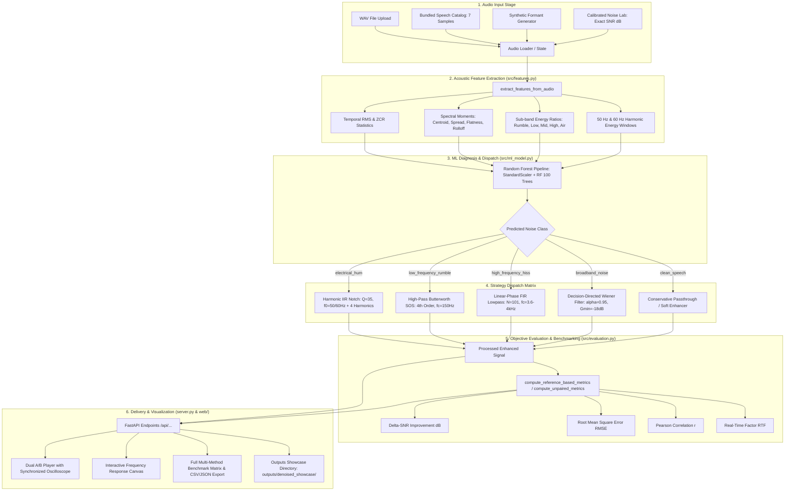

# SonicPure DSP — AI Agent Onboarding & System Reference Manual
> **Target Audience**: AI Agents (LLM Coding Assistants, Autonomous Agents, Code Analyzers)  
> **Repository Root**: `c:\Users\ayush\Desktop\DTSP`  
> **Last Verified**: October 2026 | **Python Version**: 3.11 / 3.12 | **Pytest Status**: 26/26 Passing

---

## 1. Executive Summary & Purpose

**SonicPure DSP** is an academic and industrial-grade digital signal processing (DSP) suite and real-time audio workstation. It solves speech degradation caused by acoustic interference (electrical hum, HVAC rumble, preamp hiss, and broadband background noise) without mutilating speech formants ($F_1 \approx 300\text{--}900\text{ Hz}$, $F_2 \approx 900\text{--}2500\text{ Hz}$) or unvoiced sibilants ($3.5\text{--}8\text{ kHz}$).

### Core Architecture Highlights
1. **100% Software-Only**: Fully self-contained software suite. Zero external microcontrollers, DSP boards, or hardware kits required.
2. **Machine-Learning Noise Diagnosis**: Extracts a 20-dimensional acoustic feature vector and classifies incoming noise into 5 categories via a scikit-learn Random Forest model (98.08% held-out test accuracy).
3. **Dynamic Strategy Dispatcher**: Automatically routes the audio to the mathematically optimal filter topology (Harmonic Notch Biquads, High-pass Butterworth SOS, Linear-Phase FIR, STFT Spectral Gating, or Ephraim-Malah Decision-Directed Wiener Filter).
4. **Interactive Full-Stack Web Workstation**: Single-command server powered by FastAPI serving REST APIs and a modern HTML5/CSS3/Vanilla JS single-page audio workbench with Web Audio API playback, real-time spectrograms, dual A/B comparison deck, and one-click benchmark reporting.
5. **Cross-Platform Dual Implementation**: The entire DSP and adaptive pipeline is replicated 1:1 in MATLAB / GNU Octave scripts under `matlab/`.

---

## 2. System Architecture & End-to-End Data Flow



---

## 3. Directory Layout & Key File Manifest

```
c:\Users\ayush\Desktop\DTSP
├── server.py                   # FastAPI REST backend & static web server (Port 5000)
├── run.bat                     # Quick launcher batch file calling run_workstation.bat
├── run_workstation.bat         # Automated runtime check, server startup, browser launch
├── requirements.txt            # Python dependencies (NumPy, SciPy, Librosa, Scikit-learn, FastAPI, etc.)
├── README.md                   # Full academic report, DSP math, and documentation (for humans)
├── README_AI.md                # THIS FILE: Technical specification and guide (for AI agents)
│
├── src/                        # Core Python DSP and ML modules
│   ├── __init__.py             # Package initializer
│   ├── audio_io.py             # Audio I/O, WAV byte conversion, metadata, synthetic speech generator
│   ├── noise_generation.py     # Calibrated noise generators (hum, rumble, hiss, pink/white) & SNR mixing
│   ├── filters.py              # FIR (windowed firwin), IIR Butterworth SOS, harmonic notch biquads
│   ├── spectral_denoising.py   # STFT Spectral Gating (2D smoothing) & Ephraim-Malah Wiener filter
│   ├── features.py             # 20-D acoustic feature extraction
│   ├── ml_model.py             # NoiseClassifier pipeline, training, persistence, and adaptive dispatch
│   ├── evaluation.py           # Objective metrics: Delta-SNR, RMSE, Pearson r, RTF
│   ├── reporting.py            # Summary builder, pandas dataframe conversion, markdown reporter
│   └── visualizations.py       # Matplotlib & Plotly waveform, spectrogram, and frequency response plots
│
├── web/                        # Pure HTML5 / CSS3 / Vanilla JavaScript frontend
│   ├── index.html              # Modern single-page workstation UI with glassmorphism styling
│   ├── styles.css              # Custom design system (dark mode, CSS grid/flexbox, typography)
│   └── app.js                  # AudioContext management, Canvas waveform renderer, REST API client
│
├── models/                     # Trained ML model artifacts
│   ├── noise_classifier.joblib # Serialized scikit-learn Pipeline (StandardScaler + RandomForest)
│   ├── metadata.json           # Model metadata, train/test metrics, confusion matrix, feature importances
│   └── README.md               # Model training summary and feature descriptions
│
├── matlab/                     # 1:1 algorithmic parity implementation in native MATLAB / GNU Octave
│   ├── main_audio_denoising_demo.m   # Complete interactive pipeline demonstration
│   ├── adaptive_filter_dispatch.m    # MATLAB adaptive dispatch engine
│   ├── apply_fir_filter.m            # Linear-phase FIR filter using fir1 & filtfilt
│   ├── apply_butterworth_filter.m    # Butterworth filter using butter & filtfilt
│   ├── apply_notch_filter.m          # Harmonic notch filter cascade using iirnotch
│   ├── spectral_gating.m             # STFT spectral gating with 2D smoothing
│   ├── wiener_filter_audio.m         # Decision-Directed Wiener filter
│   ├── extract_audio_features.m      # Feature extractor matching Python's feature space
│   └── README.md                     # MATLAB reproduction instructions
│
├── data/
│   ├── samples/                # Bundled clean reference speech WAV files (male, female, various f0)
│   └── README.md               # Audio dataset documentation
│
├── scripts/
│   ├── train_model.py          # Script to generate dataset, train RandomForest, evaluate, and save model
│   ├── prepare_dataset.py      # Dataset partition and feature cache generator
│   └── demo_all_filters.py     # Standalone CLI demonstration comparing all filtering algorithms
│
├── tests/                      # Automated test suite (26 Pytest tests)
│   ├── test_audio_io.py
│   ├── test_evaluation.py
│   ├── test_features.py
│   ├── test_filters.py
│   ├── test_ml_model.py
│   ├── test_noise_generation.py
│   └── test_spectral_denoising.py
│
└── outputs/                    # Output directory for exported audio and benchmark reports
    └── denoised_showcase/      # Batch exported WAV files for all 7 filter topologies
```

---

## 4. Invariant Rules & Coding Conventions for AI Agents

When modifying or extending this codebase, adhere strictly to the following invariants:

### A. Audio Signal Representation
- **Sample Rate**: Universally standardized at **$16,000\text{ Hz}$** (`sr=16000`). All loaders (`load_audio`) resample to 16 kHz by default.
- **Data Type**: 1D mono NumPy arrays of `np.float32`.
- **Amplitude Normalization**: Peak-normalized to $[-1.0, 1.0]$. Never allow audio arrays to contain `NaN` or `Inf` (use `np.nan_to_num`).
- **Channels**: Mono only (`ndim == 1`). Multi-channel audio must be averaged to mono upon load (`audio = np.mean(audio, axis=1)`).

### B. DSP Filter Topologies & Zero-Phase Filtering
- **No Phase Distortion**: Always use zero-phase forward-backward filtering (`scipy.signal.filtfilt` for FIR, `scipy.signal.sosfiltfilt` for IIR) by default (`zero_phase=True`). This ensures exactly zero group delay and preserves temporal speech alignment.
- **IIR Numerical Stability**: Never use transfer function polynomials $(b, a)$ for high-order IIR filters. Always generate Second-Order Sections (SOS) via `scipy.signal.butter(..., output='sos')`.
- **FIR Tap Order**: Symmetric Type-I FIR filters require an **odd number of taps** (e.g., $N = 101$).

### C. Spectral Restoration Parameters
- **STFT Configuration**: Default `n_fft = 512`, `hop_length = 128` (75% overlap), using a periodic Hann window.
- **Spectral Gating Smoothing**: Apply 2D smoothing (uniform or Gaussian) across adjacent time frames and frequency bins to eliminate "musical noise" (isolated spectral outliers).
- **Wiener A Priori SNR Update**: Use Ephraim-Malah Decision-Directed (DD) recursion:
  $$\hat{\xi}(k, l) = \alpha \frac{|\hat{S}(k, l-1)|^2}{\lambda_d(k, l)} + (1 - \alpha) \max(\gamma(k, l) - 1, 0)$$
  Default parameters: $\alpha = 0.95$, gain floor $G_{\min} = -18\text{ dB}$, overestimation $\beta = 1.25$.

### D. Zero-Data-Leakage ML Protocol
- **Strict Separation**: Clean speech base utterances must be partitioned into `Train` (80%) and `Test` (20%) *before* any noise mixing or feature extraction.
- **Independent Random Seeds**: Never use the same noise seed or temporal segments across train and test splits.
- **Model Pipeline**: Always maintain `StandardScaler()` followed by `RandomForestClassifier()` inside a scikit-learn `Pipeline`.

### E. Hardware Constraints
- **100% Software**: Do not introduce dependencies on external microcontrollers, Arduino, Raspberry Pi, or ESP32. All processing runs on the host machine CPU.

---

## 5. Core Module Technical Breakdown

### `src/audio_io.py`
- `load_audio(file_path_or_buffer, target_sr=16000) -> (np.ndarray, int)`: Robust audio loader supporting file paths or in-memory byte streams via `librosa`/`soundfile`.
- `save_audio(file_path, audio, sr=16000)`: Writes 16-bit PCM WAV.
- `audio_to_bytes(audio, sr=16000) -> bytes`: In-memory WAV encoding for FastAPI streaming.
- `get_audio_metadata(audio, sr=16000) -> dict`: Computes duration, sample rate, peak amplitude, RMS energy, and estimated SNR.
- `generate_clean_speech_synthetic(duration=3.5, sr=16000, seed=42) -> np.ndarray`: Formant-synthesized speech signal with fundamental pitch modulation ($F_0 \approx 110\text{--}220\text{ Hz}$) and resonance formants ($F_1, F_2, F_3$) for offline testing.

### `src/noise_generation.py`
- `mix_speech_and_noise(speech, noise, target_snr_db=5.0) -> (noisy, scaled_noise, meta)`: Computes exact mathematical energy scaling:
  $$E_s = \frac{1}{N}\sum s[n]^2, \quad E_n = \frac{1}{N}\sum n[n]^2, \quad \alpha = \sqrt{\frac{E_s}{E_n \cdot 10^{\text{SNR}_{\text{target}}/10}}}$$
- `generate_electrical_hum(n_samples, sr=16000, base_freq=50.0)`: 50 Hz or 60 Hz fundamental + 3 harmonics with subtle phase jitter.
- `generate_low_frequency_rumble(n_samples, sr=16000, cutoff_hz=130.0)`: Low-pass filtered noise simulating air-conditioning/HVAC airflow.
- `generate_high_frequency_hiss(n_samples, sr=16000, cutoff_hz=3600.0)`: High-pass filtered noise simulating preamplifier tape hiss.
- `generate_broadband_noise(n_samples, sr=16000, noise_type="pink"|"white")`: Pink ($1/f$) or white ($1/f^0$) noise.
- `generate_mixed_noise(n_samples, sr=16000)`: Realistic acoustic mixture combining rumble, hum, and broadband noise.

### `src/filters.py`
- `apply_fir_filter(audio, cutoff, num_taps=101, btype='lowpass', window='hamming', sr=16000, zero_phase=True)`: Windowed linear-phase FIR.
- `apply_butterworth_filter(audio, cutoff, order=4, btype='highpass', sr=16000, zero_phase=True)`: Second-order sections (SOS) IIR Butterworth filter.
- `apply_notch_filter(audio, notch_freq=50.0, q=35.0, include_harmonics=True, max_harmonics=4, sr=16000, zero_phase=True)`: Cascaded biquad notch filter targeting base frequency and integer harmonics.
- `compute_fir_response`, `compute_iir_sos_response`, `compute_notch_response`: Frequency response generators for interactive frontend plotting.

### `src/spectral_denoising.py`
- `estimate_noise_profile(y, sr=16000, n_fft=512, hop_length=128, noise_segment=None)`: Estimates noise PSD and magnitude from quietest 20% percentile frames or designated noise segment.
- `spectral_gating(y, sr=16000, suppression_db=-18.0, over_subtraction=1.5, time_smoothing=2, freq_smoothing=2)`: STFT subtraction with 2D smoothing.
- `wiener_filter_audio(y, sr=16000, alpha=0.95, overestimation=1.25, gain_floor_db=-18.0)`: Ephraim-Malah Decision-Directed a priori SNR tracking.

### `src/features.py`
- `extract_features_from_audio(audio, sr=16000) -> (feature_vector, feature_dict)`: Extracts ordered 20-dimensional feature vector:
  1. `rms_mean`, 2. `rms_std`
  3. `zcr_mean`, 4. `zcr_std`
  5. `spectral_centroid_mean`, 6. `spectral_centroid_std`
  7. `spectral_flatness_mean`, 8. `spectral_flatness_std`
  9. `spectral_rolloff_mean`, 10. `spectral_rolloff_std`
  11. `energy_ratio_rumble` ($0\text{--}150\text{ Hz}$)
  12. `energy_ratio_low` ($150\text{--}500\text{ Hz}$)
  13. `energy_ratio_mid` ($500\text{--}3000\text{ Hz}$)
  14. `energy_ratio_high` ($3000\text{--}6000\text{ Hz}$)
  15. `energy_ratio_air` ($6000\text{--}8000\text{ Hz}$)
  16. `dominant_peak_freq`
  17. `dominant_peak_ratio`
  18. `hum_50hz_ratio` ($48\text{--}52\text{ Hz}$)
  19. `hum_60hz_ratio` ($58\text{--}62\text{ Hz}$)
  20. `spectral_bandwidth_mean`

### `src/ml_model.py`
- `NoiseClassifier`: Encapsulates model training, persistence (`joblib`), prediction, and strategy dispatch.
- **Classes**:
  - `electrical_hum`
  - `low_frequency_rumble`
  - `high_frequency_hiss`
  - `broadband_noise`
  - `clean_speech`
- `apply_adaptive_filter(audio, sr=16000) -> (filtered_audio, prediction_dict, strategy_dict)`: Extracts features, infers class, and dispatches the corresponding filter.

### `src/evaluation.py`
- `compute_reference_based_metrics(clean_ref, noisy_input, processed, sr=16000, processing_time_sec=0.0)`:
  - Input SNR, Output SNR, $\Delta\text{SNR}$ improvement ($\text{dB}$)
  - RMSE (Root Mean Square Error against clean reference)
  - Pearson correlation coefficient ($r \in [-1, 1]$)
  - Processing latency and Real-Time Factor ($\text{RTF} = T_{\text{proc}} / T_{\text{audio}}$)
- `compute_unpaired_metrics(noisy_input, processed, sr=16000, processing_time_sec=0.0)`: Blind metrics when ground truth clean reference is absent (e.g. user upload).

---

## 6. FastAPI REST Endpoints Reference

Base URL when running locally: `http://localhost:5000`

| Method | Endpoint | Description | Key Parameters | Response Format |
|---|---|---|---|---|
| `GET` | `/api/status` | System status, audio metadata, model readiness | None | JSON (`{status, sample_rate, active_sample_name, audio_metadata, ...}`) |
| `GET` | `/api/samples` | List available clean speech samples | None | JSON (`{samples: [...], active_sample_id}`) |
| `POST` | `/api/select-sample` | Change active speech sample | `sample_id`, `preset` (Form) | Status JSON |
| `POST` | `/api/quick-preset` | Quick load scenario (hum, rumble, hiss, broadband, clean) | `preset` (Form: "hum" \| "rumble" \| "hiss" \| "broadband" \| "clean") | Status JSON |
| `POST` | `/api/mix-noise` | Calibrated noise mixing at specified SNR | `noise_type` (Form), `snr_db` (Form: float) | JSON (`{status, measured_snr_db, metadata}`) |
| `POST` | `/api/upload` | Upload custom WAV recording | `file` (WAV), optional `ref_file` (WAV) | Status JSON |
| `POST` | `/api/apply-filter` | Execute chosen DSP filter with custom parameters | `filter_type` ("fir" \| "iir" \| "notch" \| "spectral_gating" \| "wiener"), plus cutoffs/taps/order | JSON (`{status, method, processing_time_ms, metrics, info}`) |
| `POST` | `/api/adaptive-ml` | Run 20-D feature extraction, ML diagnosis & auto-filtering | None | JSON (`{status, prediction, strategy, processing_time_ms, metrics}`) |
| `POST` | `/api/benchmark` | Execute benchmark across all 6 strategies + baseline | None | JSON (`{status, results: [metrics per method]}`) |
| `POST` | `/api/export-all-unnoised` | Batch filter & export 7 WAV files to disk | None | JSON (`{status, output_directory, saved_files}`) |
| `GET` | `/api/audio/{track_type}` | Stream in-memory audio as 16-bit PCM WAV | `track_type`: `"noisy"`, `"clean"`, `"processed"`, or method ID (`"fir"`, `"notch"`, etc.) | Binary `audio/wav` stream |
| `GET` | `/api/waveform-data` | Downsampled points for Canvas waveform | `track` ("both"), `samples` (int, default 400) | JSON (`{noisy: [...], processed: [...], clean: [...]}`) |
| `GET` | `/api/filter-response` | Theoretical filter magnitude response | `filter_type`, `cutoff`, `cutoff_high`, `btype`, `order`, `q` | JSON (`{frequencies: [...], magnitude_db: [...]}`) |
| `GET` | `/api/export/csv` | Download active benchmark matrix as CSV | None | File download: `sonicpure_benchmark.csv` |
| `GET` | `/api/export/json` | Download full experiment provenance JSON | None | File download: `sonicpure_experiment.json` |

---

## 7. Operational Workflows & Commands

### A. Environment Setup & Dependency Installation
```powershell
# Navigate to repository root
cd c:\Users\ayush\Desktop\DTSP

# Install required dependencies
pip install -r requirements.txt
```

### B. Running Automated Tests (Verification)
```powershell
# Run the complete test suite
pytest tests/ -v
```
*Expected Result*: 26 passed tests covering I/O, noise generators, feature extraction, filters, spectral denoisers, ML classifier, and evaluation metrics.

### C. Launching the Workstation
```powershell
# Launch backend server and open browser to http://localhost:5000
python server.py
# Or use the convenience batch script:
run.bat
```

### D. Retraining the ML Noise Classifier
```powershell
# Retrains the Random Forest pipeline on synthetic partitioned speech with zero data leakage
python scripts/train_model.py
```
*Artifacts Produced*:
- `models/noise_classifier.joblib`: Serialized model pipeline
- `models/metadata.json`: Evaluation report and feature importances

### E. Running Offline Multi-Filter Benchmark
```powershell
# Compares FIR, IIR, Notch, Spectral Gating, Wiener, and ML-Adaptive on test audio
python scripts/demo_all_filters.py
```

---

## 8. State Lifecycle in `server.py`

The FastAPI server maintains a global singleton instance: `state = StudioState()`.

```python
class StudioState:
    sr: int = 16000                       # Fixed sampling rate
    active_sample_id: str                 # ID of active clean reference WAV
    active_noise_preset: str              # Active scenario ("hum", "rumble", etc.)
    clean_reference: Optional[np.ndarray] # Ground truth clean audio
    current_audio: np.ndarray             # Active noisy audio under test
    processed_audio: Optional[np.ndarray] # Output of the most recent filter run
    last_method: Optional[str]            # Human-readable name of last filter run
    last_exec_info: dict                  # Algorithm parameters and processing time
    audio_source_name: str                # UI display label
    has_clean_ref: bool                   # True if paired ground truth exists
    is_simulated: bool                    # True if created via Calibrated Noise Lab
    ml_prediction: Optional[dict]         # Latest ML diagnosis output
    benchmark_results: list               # Multi-method comparison table
    method_audio_cache: dict              # In-memory storage for each benchmarked filter
    classifier: NoiseClassifier           # Loaded Random Forest instance
```

**Key Agent Gotcha**: When writing tests or scripts against `server.py`, remember that state is mutable and persistent across HTTP calls during a server session. Testing individual endpoints in isolation without resetting `state` may reflect previous audio mutations.

---

## 9. Common Extensions & How an AI Agent Should Implement Them

### 1. Adding a New Noise Generation Type
1. Define the generator in [src/noise_generation.py](file:///c:/Users/ayush/Desktop/DTSP/src/noise_generation.py):
   ```python
   def generate_custom_noise(n_samples: int, sr: int = 16000, **kwargs) -> np.ndarray: ...
   ```
2. Add unit tests in [tests/test_noise_generation.py](file:///c:/Users/ayush/Desktop/DTSP/tests/test_noise_generation.py).
3. Update [src/ml_model.py](file:///c:/Users/ayush/Desktop/DTSP/src/ml_model.py) `CLASSES` list if it is a new classification class.
4. Add the branch to `/api/mix-noise` in [server.py](file:///c:/Users/ayush/Desktop/DTSP/server.py).
5. If retrained, run `python scripts/train_model.py`.

### 2. Adding a New Filter Topology
1. Implement the filter function in [src/filters.py](file:///c:/Users/ayush/Desktop/DTSP/src/filters.py) or [src/spectral_denoising.py](file:///c:/Users/ayush/Desktop/DTSP/src/spectral_denoising.py).
2. Ensure it supports `zero_phase: bool = True` and returns `(filtered_audio, filter_info)`.
3. Add a test in [tests/test_filters.py](file:///c:/Users/ayush/Desktop/DTSP/tests/test_filters.py).
4. Add handling in `/api/apply-filter`, `/api/benchmark`, and `/api/export-all-unnoised` in [server.py](file:///c:/Users/ayush/Desktop/DTSP/server.py).
5. Add UI controls in [web/index.html](file:///c:/Users/ayush/Desktop/DTSP/web/index.html) and event listeners in [web/app.js](file:///c:/Users/ayush/Desktop/DTSP/web/app.js).

### 3. Adding a New Acoustic Feature
1. Append the feature name to `FEATURE_NAMES` in [src/features.py](file:///c:/Users/ayush/Desktop/DTSP/src/features.py).
2. Calculate the scalar value inside `extract_features_from_audio`.
3. Retrain model using `python scripts/train_model.py` to regenerate `models/noise_classifier.joblib` and `models/metadata.json`.
4. Verify all tests pass with `pytest tests/ -v`.

---

## 10. Summary Checklist for AI Collaborator

- [x] Audio array: Always 1D `float32`, $16,000\text{ Hz}$, normalized to $[-1.0, 1.0]$.
- [x] Zero-phase filtering: Preserve phase via `filtfilt` and `sosfiltfilt`.
- [x] Spectral gating: Always apply 2D time-frequency smoothing to suppress musical noise.
- [x] Unit tests: Run `pytest tests/ -v` before committing any code changes.
- [x] Hardware: Never assume or add requirements for hardware/microcontroller components.
- [x] Cross-platform: Maintain parity with `matlab/` when core DSP algorithms are updated.
